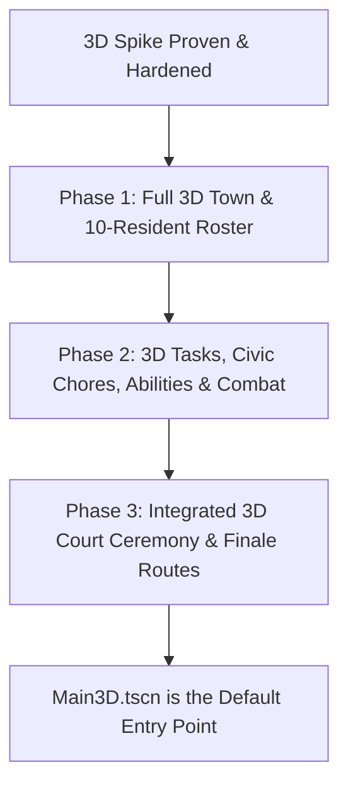

# Implementation Plan: Full 3D Game Conversion

## Overview
Migrate *The Gray Synthesis* from a 2D top-down game to a full 3D top-down isometric experience. This plan establishes an incremental, test-driven roadmap that guarantees zero regressions to existing match logic and tests while delivering an authentic 3D social deduction and tactical MOBA game.

**Workspace status:** The 3D conversion is implemented through the integrated match loop. `project.godot` launches `scenes/Main3D.tscn`; Phase 1, Phase 2, and Phase 3 verification scripts are present. The sections below document the implementation roadmap and its verification coverage, not the current development phase.

---

## Roadmap

### Phase 1: Full 3D Town Map & 10-Resident Roster (Implemented)
- **3D Town Environment (`scripts/TownMap3D.gd` & `scenes/TownMap3D.tscn`):**
  - Build out all four town sectors in 3D space:
    1. **Pump & Generator Station:** Aquifer reservoir, Overdrive Generator, pipeline trestles, and static perimeter walls.
    2. **Greenhouse & Hydroponic Fields:** Soil plots, glass canopy ribs, irrigation conduits, and compost bins.
    3. **Salvage Yard & Workshop:** Scrap metal stacks, crane gantry frame, recycling sorters.
    4. **Town Square & Council Plaza:** Raised marble/concrete voting podium, central council circle with 10 resident seats, Clinic bay.
  - **Archive Secrecy & 4 Identical Alcoves:**
    - Do NOT place a visible "Archive" pad or label.
    - Build four identical-looking secluded weathered bedrock alcoves across the town sectors.
    - Synchronize one randomly activated alcove per match with `GameManager.archive_active_spawn_id`. All 4 look identical until inspected.
  - **Task Pads (Presence & Spatial Placement):**
    - Place the primary civic pads (`pump`, `greenhouse`, `salvage`, `clinic`, `common_works`).
    - Place `generator` and `beacon`, but visibly mark them as `[Locked until Escalation]` with dim amber styling.
    - Keep interactive task effects focused on Phase 2; Phase 1 proves spatial presence, layout, and waypoint accessibility.
  - Spatial region detection (`get_region_name_at_3d`) and broad regional alert anchors (`get_region_alert_anchor_at_3d`).
- **3D Waypoint Navigation System:**
  - Build a 3D waypoint node network connecting all sectors, corridors, and pads.
  - Implement 3D pathfinding (A* or waypoint graph navigation) so bots navigate around walls and buildings cleanly.
- **10-Resident 3D Roster (`scripts/Resident3D.gd`):**
  - Unified `CharacterBody3D` resident class supporting both Player and AI Bots.
  - Faction-neutral workwear visuals (capsule, backpack, headlamp) and distinctive civic job tools (wrench, sickle, torch, clipboard, scanner).
  - Integrate with `GameManager.start_match()`: assigns 3 Ecology, 3 Technology, and 4 Civilians.
  - 9 AI bots navigating between chores across the 4 sectors via 3D waypoints.
- **Main 3D Scene (`scenes/Main3D.tscn` & `scripts/Main3D.gd`):**
  - Orchestrates the full 10-resident session, camera follow, and HUD in 3D.
  - `scenes/Main3D.tscn` is the project launcher; `scenes/Main.tscn` remains available as the 2D scene.
- **Automated Verification Suite (`test_full_3d_phase1.gd`):**
  - Verifies 10 residents, role distribution, waypoint navigation around 3D obstacles, 4 secret alcoves (1 active, identical visuals), locked generator/beacon labels, and sightline checks.

### Phase 2: 3D Tasks, Civic Chores, Faction Abilities & Combat (Implemented)
- Full channeling interaction on all 8 task pads for player and bots.
- 6 operative faction abilities implemented in 3D with particle effects and collision zones.
- Knockdown, stamina exhaustion, and Clinic medical recovery walk in 3D.
- Signal Beacon frequency tuning and 3D line-of-sight buffs.

### Phase 3: Integrated 3D Court Ceremony, Finale Routes & Main Entry Point (Implemented)
- Merge the 3D Court Ceremony into the main match loop:
  - When `Phase.COURT` begins, all 10 residents assemble around the Council Ring.
  - The 4 Civilians physically walk up to the raised podium one by one, deliver their spoken testimony in 3D speech balloons, and cast live ballots.
  - Seamless handoff to 4–0 Mandate instant win or Strategic Window.
- 3D Finale: Generator tug-of-war overdrive arena or Common Works crisis holdout.
- `Main3D.tscn` is set as the primary game entry point in `project.godot`.

---

## Phase 1 Detailed Implementation Plan (Completed & Verified)

### 1. `scripts/TownMap3D.gd` & `scenes/TownMap3D.tscn`
- **Sectors (XZ Plane):**
  - Town Square: Center `(0, 0)`, radius 14m.
  - Pump & Generator: North `(0, 24)`, bounds `X: -28..28, Z: 10..38`.
  - Greenhouse: South-West `(-20, -22)`, bounds `X: -38..-4, Z: -38..-10`.
  - Salvage Yard: South-East `(20, -22)`, bounds `X: 4..38, Z: -38..-10`.
- **Static Geometry:** Ground plane with stone/dirt materials, perimeter walls, building grayboxes, and arches between sectors.
- **Task Pads (Civic & Escalation-Locked):**
  - Civic pads active in Open Town:
    - `pump` at `Vector3(-6, 0.05, 24)`
    - `greenhouse` at `Vector3(-20, 0.05, -20)`
    - `salvage` at `Vector3(20, 0.05, -20)`
    - `clinic` at `Vector3(0, 0.05, -10)`
    - `common_works` at `Vector3(-12, 0.05, 0)`
  - Escalation-locked landmarks (labeled `[Locked until Escalation]` with dim amber styling):
    - `generator` at `Vector3(6, 0.05, 24)`
    - `beacon` at `Vector3(0, 0.05, 28)`
- **Secluded Bedrock Alcoves (Archive Secrecy):**
  - 4 identical-looking recessed alcoves with subtle stone styling and neutral label `Secluded Bedrock Alcove [V]`:
    - `north_pass` at `Vector3(0, 0.05, 34)`
    - `salvage_alcove` at `Vector3(28, 0.05, -24)`
    - `pump_basin` at `Vector3(-24, 0.05, 26)`
    - `council_niche` at `Vector3(-14, 0.05, 8)`
  - One alcove is randomly activated per match via `game_manager.archive_active_spawn_id`. All 4 alcoves look identical until inspected. There is no visible "Archive" pad or leak.
- **Raycast & AABB Line-of-Sight:**
  - `has_clear_sightline_3d(from_pos: Vector3, to_pos: Vector3) -> bool`
  - `get_region_name_at_3d(pos: Vector3) -> String`
  - `get_region_alert_anchor_at_3d(pos: Vector3) -> Vector3`

### 2. `scripts/Resident3D.gd` & `scripts/ResidentBotController3D.gd`
- Unified character functionality:
  - WASD / velocity movement, acceleration, friction, sprint stamina drain and recovery.
  - 3D Capsule collision (`radius = 0.45`, `height = 1.85`).
  - Procedural character mesh styling matching the 3D Court aesthetic:
    - Neutral workwear khaki/slate/sand canvas.
    - Headlamp with soft forward cone light.
    - Held tool prop representing civic job (`Pump Technician` = wrench, `Crop Tender` = sickle, `Salvage Quartermaster` = blowtorch, `Field Medic` = scanner, `Town Watch` = baton).
- `scripts/ResidentBotController3D.gd`:
  - 3D Waypoint navigation: selects target sector/pad, queries 3D waypoint graph, walks waypoint to waypoint around obstacles.
  - Simulates civic chores during Open Town.

### 3. `scripts/Main3D.gd` & `scenes/Main3D.tscn`
- Spawns `GameManager`, `TownMap3D`, and 10 `Resident3D` nodes in the Town Square council ring.
- Follow camera tracks the player with smooth isometric damping.
- Integrates screen-space 2D HUD over 3D viewport.
- `project.godot` launches `Main3D.tscn`; `Main.tscn` remains available as the 2D scene.

### 4. Verification Results (Phase 1)
- **Phase 1 Test Suite (`test_full_3d_phase1.gd`):** **48 / 48 PASSED (100%)**
  - Group 1 (10-Resident Roster, Roles & Phase Consistency): 14/14 passed (3 Eco, 3 Tech, 4 Civilians, tools, collision, Briefing assembly hold, dynamic HUD phase updates from `GameManager.get_phase_name()`).
  - Group 2 (Town Map & Sectors): 7/7 passed.
  - Group 3 (Task Pads & Locked Landmarks): 6/6 passed (Generator and Beacon locked).
  - Group 4 (Archive Secrecy & 4 Alcoves): 5/5 passed (1 active, identical visuals, no leak).
  - Group 5 (Waypoint Graph & Pathfinding): 8/8 passed (clean paths around walls).
  - Group 6 (Sightlines & Regional Anonymity): 8/8 passed.
- **3D Slice Test Suite (`test_slice_3d_integration.gd`):** **38 / 38 PASSED (100%)**
- **Milestone 7 Verification Suite (`test_milestone_7_verification.gd`):** **64 / 64 PASSED (100%)**
- **Milestone 6 Verification Suite (`test_milestone_6_verification.gd`):** **52 / 52 PASSED (100%)**
- **Exported Release Binary (`build/The Gray Synthesis.exe`):** Built cleanly and smoke-tested with exit code 0.
